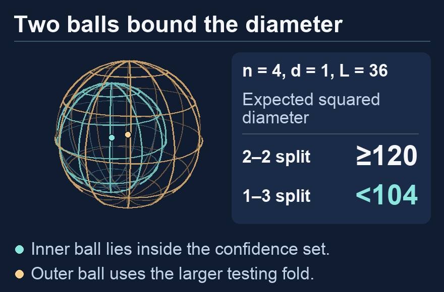

# Unequal splits can shrink cross-fit Gaussian confidence sets

   

For four observations from a univariate Gaussian with known unit variance and noncoverage level exp(−36), the expected squared diameter of a two-fold cross-fit confidence set is below 104 for a 1–3 split and at least 120 for a 2–2 split. This refutes the balanced-split conjecture of Dunn, Ramdas, Balakrishnan and Wasserman.

[Read the paper](paper/manuscript.pdf) · [LaTeX source](paper/manuscript.tex) · [Original conjecture](https://arxiv.org/html/2104.14676v3#S3.SS1) · [Dunn’s dissertation](https://robinmdunn.github.io/files/RobinDunn-dissertation.pdf#page=145) · [Catalog Q563](https://github.com/10m-u/open-problems-catalog/blob/ca8d4d44ba3db527f19f28928c240168f545ecfe/problems/computer_science_ai/classical-statistical-machine-learning.md#q563) · [Version DOI](https://doi.org/10.5281/zenodo.24571972)

## Explore the proof in 3D

The turquoise ball lies inside the cross-fit set. The gold ball encloses it. Those radii use a fixed distance between fold means. Averaging the resulting diameter bounds over the Gaussian sample proves the numbers shown on the right. In the explorer you can rotate the balls, change the distance between the means, and vary the noncoverage level to see when the comparison certifies an improvement.

[Download the offline explorer](https://raw.githubusercontent.com/DannyExperiments/cross-fit-gaussian-unequal-splits/v1.0.0/visualization/cross-fit-balls-explorer.zip) · [Explorer source](visualization/index.html) · [GIF rendering source](visualization/render.py)

## Why the proof works

Each directional likelihood ratio has spherical sublevel sets. Requiring both ratios below the cutoff gives an inner bound. The average below the cutoff forces each ratio below twice the cutoff and gives an outer bound. Both bounds have leading expected squared diameter 8 log(1/α)/M, where M is the larger fold size. The 1–(n−1) and (n−1)–1 splits therefore minimize the expected squared diameter for sufficiently small α at fixed sample size and dimension. At each fixed unequal split the larger fold determines the constant term as well.

## Reproduce the checks

    python3 -I scripts/verify_repository.py
    python3 -I verification/src/replay.py

The [recorded replay](verification/results/replay.txt) checks the likelihood identities, both finite examples, balanced factorization and unequal asymptotics. See the [source comparison](audits/public_safe_reports/LITERATURE.md), [scope](CLAIM_SCOPE_AND_LIMITATIONS.md), [reproducibility](REPRODUCIBILITY.md), and [research disclosure](AI_DISCLOSURE.md).

## Cite

DannyExperiments. *Unequal splits can shrink cross-fit Gaussian confidence sets*. Version 1.0.0, 27 November 2026. [Version DOI](https://doi.org/10.5281/zenodo.24571972).
